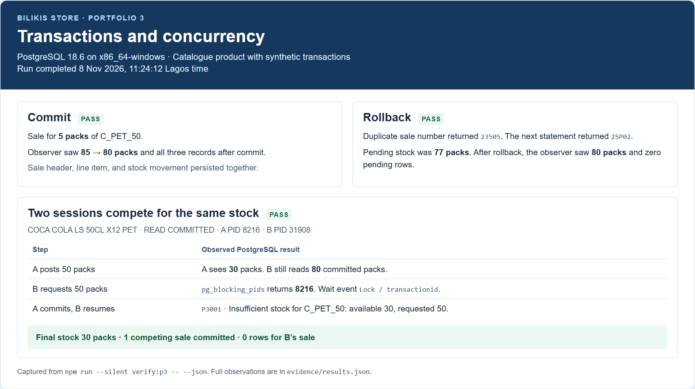
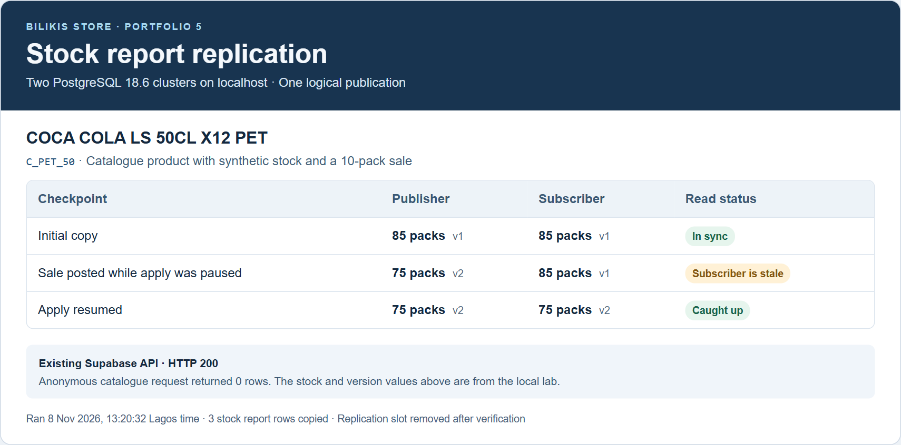

# Bilikis Store Database Portfolio

Raji Abdulsamad  |  Registration 301876927  |  Matriculation 2026/A/MIT/0273

a.raji6927@miva.edu.ng  |  8th November 2026

[GitHub repository](https://github.com/abdulraji36-afk/Raji_Abdulsamad_301876927)

## Organisation and scope

Bilikis Store is distributing drinks in PET plastic bottles and returnable glass bottles (RGB). Supabase backs the operations app to capture stock receipts and sales, assign sales to dispatch trips, and keep track of empty containers that are due from customers. That workflow is used in the portfolio to verify the impact of database design on making good stock decisions and reporting.

The exercises are based on the Bilikis backend with a local schema. Product codes, names, size, and units have been retained in three catalogue entries. Customer records, sales, prices, stock and dispatch activity are synthetic.

## Portfolio 1 Database design

The PostgreSQL model has 24 application tables and a single local identity fixture. The ER diagram has 25 entities and 32 foreign keys. The sale headers and sale lines are allowed to have multiple products sold under the same header, with customer and product information maintained in separate tables. The price entered in the sale line is maintained. The inventory view uses stock movements, and dispatch assignments track empty containers separately.

The verifier passed 34 checks such as rejection of an orphan sale item and a duplicate dispatch assignment. The schema includes generated totals for line calculations and JSONB for audit snapshots.

[Full ER diagram](portfolio-1-database-design/diagrams/full-schema.png)  |  [Schema and validation results](portfolio-1-database-design/README.md)

## Portfolio 2 Query optimisation

Six SQL reports checked stock, sales, outstanding empties, valuation, customer history and product movements. A separate benchmark with 60,002 synthetic PET sales compared two selective queries before and after adding indexes. Each median uses seven measured executions after warm-up in PGlite.

| Query | Median execution time | Shared buffer accesses |
| --- | ---: | ---: |
| PET sales by customer | 8.457 ms → 0.097 ms | 1,038 → 27 |
| Stock movements by product | 6.610 ms → 0.182 ms | 888 → 83 |

The customer history index removed a sequential scan and sort. The movement index enabled a bitmap scan. Both queries returned the same results in each phase. The timings describe the local benchmark.

[SQL and benchmark](portfolio-2-query-optimisation/README.md)  |  [Execution plans and measurements](portfolio-2-query-optimisation/evidence/results.json)

## Portfolio 3 Transactions and concurrency

Posting a PET sale writes its header, line item and stock movement in one transaction. A five-pack sale became visible to a separate session after commit and reduced stock from 85 to 80 packs. A duplicate sale number then forced a rollback in a separate test. The attempted sale left stock at 80 and saved none of its three rows.

Under READ COMMITTED, two sessions each tried to sell 50 packs. Session B waited for Session A’s product row lock. After A committed, B checked the ledger again, found 30 packs available and rolled back. The control depends on competing writes for the product using the same lock.

*Figure 1. PostgreSQL commit, rollback and two-session lock evidence.*

[Transaction SQL and results](portfolio-3-transactions-concurrency/README.md)

## Portfolio 4 NoSQL modelling

The MongoDB sales collection embeds line items and an optional dispatch summary because a sale detail screen reads them together. Four posted sales were imported. The verifier created, read, updated and deleted a separate draft, and schema validation rejected a document with an empty line array.

MongoDB and PostgreSQL agreed on the PET and RGB sales totals and the two empties outstanding for RGB-001. PostgreSQL remains the source of truth for stock. Embedded product and dispatch details are snapshots, so a live document view would need a refresh policy.

[MongoDB model, operations and aggregate checks](portfolio-4-nosql/README.md)

## Portfolio 5 Distributed and cloud databases

A logical publication copied a three-product stock report between two local PostgreSQL instances. With the subscription paused, a ten-pack sale brought the publisher to 75 packs while the subscriber still showed 85. The subscriber caught up to 75 packs when replication resumed.

Stock approval needs the primary, while a report can use a subscriber when readers can tolerate delay. The exercise discusses separate backups, restore testing and possible warehouse-based sharding. The hosted Supabase API returned HTTP 200 and zero rows for an anonymous catalogue query. Replication was tested locally.

*Figure 2. Stock report checkpoints on two PostgreSQL instances.*

[Replication lab and hosted API evidence](portfolio-5-distributed-cloud/README.md)

## Individual reflection

This assignment was particularly interesting to me because I was able to work with something I had already built myself. Before the assignment, I had personally developed the Bilikis Store Operational App, including its database schema and product structure. Instead of starting an entirely new project, I decided to reuse the schema I had already designed and copy a few sample products from the application for this assignment.

At first, I thought that once the stock balance was correct in the database, it would be safe to use for a sale. However, working through the two-session test helped me realize that things are not always that straightforward. A stock balance might be correct when checked, but another transaction could change it before the sale is completed. This made me understand why proper locking and transaction management are important, especially in a real store where multiple sales could happen at the same time.

If I were to improve my application, I would make sure that sales are approved through the primary database and that the stock ledger is checked after acquiring the product lock. I would also include a last refresh time on stock reports so users know how recent the information is.

What I appreciated most about this assignment was that it made me look at my own application differently. I was not just completing a database exercise; I was learning about potential problems that could affect a system I had personally developed. It helped me see areas where I could improve the Bilikis Store Operational App and reminded me that building an application is not only about making it work, but also about making sure it remains reliable when people actually use it.

## References

[PostgreSQL EXPLAIN](https://www.postgresql.org/docs/18/sql-explain.html)  |  [Transaction isolation](https://www.postgresql.org/docs/18/transaction-iso.html)  |  [Logical replication](https://www.postgresql.org/docs/18/logical-replication.html)  |  [MongoDB data modelling](https://www.mongodb.com/docs/manual/data-modeling/best-practices/)

## AI use

I personally developed the Bilikis Store Operational App, including its database schema, and reused a few sample products for this assignment.

I used OpenAI Codex to assist with SQL scripts, verification, diagrams, evidence presentation, All findings were based on actual database tests I carried out, reviewed, and interpreted myself.
