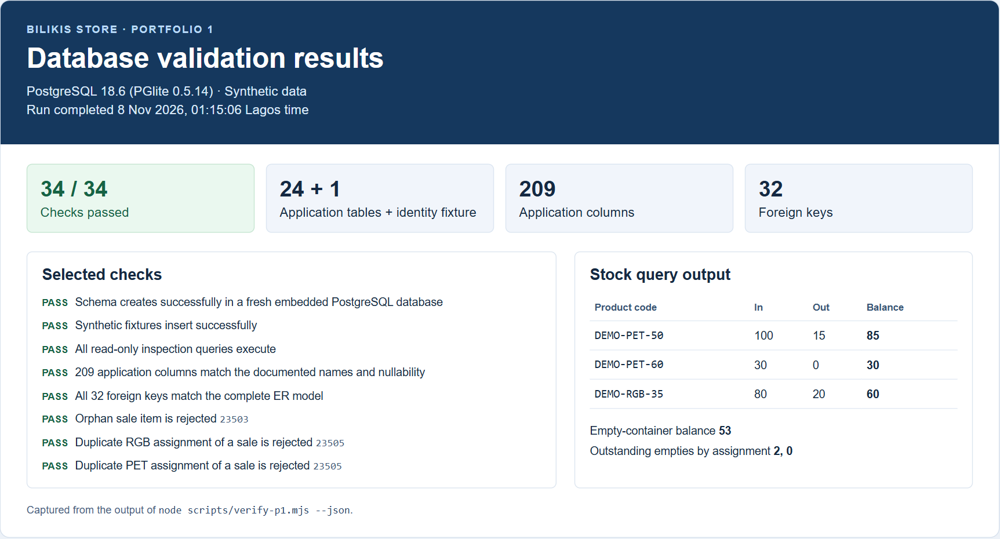

# Portfolio 1 — Database Design and Modelling

## Selected organisation

The selected organisation is Bilikis Store, a beverage distribution business. Its operations app manages sales, inventory and deliveries for drinks in plastic (PET) and returnable glass (RGB) bottles. Sales staff, storekeepers, delivery staff, managers and administrators use the database through the app.

The database stores products, customers, staff profiles, stock receipts and movements, sales and line items, dispatch trips, empty-container returns and audit logs. It supports receiving stock, requesting and approving PET sales, assigning orders to trips, recording returns, checking outstanding empties, and reporting on stock and sales. The database tracks stock and empty-container balances separately.

The standalone `bilikis` schema has 24 application tables, 209 application columns, and a small `auth_users` identity fixture. It adapts the supplied Supabase table extract using the Bilikis application migrations for enum definitions, generated totals, NBC reference checks, and void metadata. The exercise uses synthetic records and covers table design and data integrity. Production authentication, permissions, application triggers, and external notification delivery are outside its scope.

## ER diagram

The full diagram shows all 25 entities and 32 declared foreign keys, including optional staff references. Zoom in to read column types, keys, and cardinalities. [Open the PNG](diagrams/full-schema.png) · [Open the SVG](diagrams/full-schema.svg)

## Relational schema

The primary key is `id` unless stated otherwise. Each foreign key in the table below references the target table's `id`. The SQL and diagram list every column and type. [Schema SQL](sql/01-schema.sql)

| Table | Foreign keys | Other keys or role |
|---|---|---|
| `auth_users` | — | Local identity fixture |
| `profiles` | `id` → `auth_users` | Shared primary key |
| `products` | — | Unique `product_code` |
| `customers` | `created_by` → `profiles` | Unique `customer_code` |
| `stock_in` | `created_by` → `profiles` | Unique `stock_in_no` when supplied |
| `stock_in_items` | `stock_in_id` → `stock_in`, `product_id` → `products` | Receipt quantity and unit cost |
| `pet_sales` | `customer_id` → `customers`, `requested_by`, `approved_by`, `voided_by` → `profiles` | Unique `request_no` and `sales_no` when supplied |
| `pet_sale_items` | `pet_sale_id` → `pet_sales`, `product_id` → `products` | Quantity and approved price |
| `rgb_sales` | `customer_id` → `customers`, `created_by`, `voided_by` → `profiles` | Unique `sale_no` when supplied |
| `rgb_sale_items` | `rgb_sale_id` → `rgb_sales`, `product_id` → `products` | Quantity and price per crate |
| `pet_dispatch_trips` | `created_by` → `profiles` | Unique `trip_no` when supplied |
| `pet_dispatch_trip_sales` | `dispatch_trip_id` → `pet_dispatch_trips`, `pet_sale_id` → `pet_sales` | Unique `pet_sale_id` |
| `rgb_dispatch_trips` | `created_by` → `profiles` | Unique `trip_no` when supplied |
| `rgb_dispatch_trip_sales` | `dispatch_trip_id` → `rgb_dispatch_trips`, `rgb_sale_id` → `rgb_sales` | Unique `rgb_sale_id`. Records expected and initially returned empties |
| `rgb_empty_return_followups` | `dispatch_trip_sale_id` → `rgb_dispatch_trip_sales`, `recorded_by` → `profiles` | Additional returns against a dispatch assignment |
| `empty_opening_balance` | `updated_by` → `profiles` | Singleton opening balance |
| `empty_exchanges` | `created_by` → `profiles` | Unique `exchange_no` when supplied |
| `empty_adjustments` | `created_by` → `profiles` | Signed balance corrections |
| `stock_movements` | `product_id` → `products`, `created_by` → `profiles` | Ledger used by `current_stock_view` |
| `dispatch_workers` | `created_by` → `auth_users` | Worker directory |
| `audit_logs` | `user_id` → `profiles` | Before and after snapshots |
| `document_sequences` | — | Composite primary key `(sequence_key, sequence_date)` |
| `telegram_notification_settings` | — | Singleton settings |
| `telegram_notification_outbox` | `audit_log_id` → `audit_logs` | Unique `event_key` |
| `product_display_order` | — | Singleton display settings |

## Keys, constraints, and business rules

- Each sale belongs to one customer. A customer can have many sales. Receipt and sale lines reference their header and a product. The workflow requires at least one line per header.
- Each trip can carry many sales. The unique sale foreign key limits each sale to one assignment per sales channel. An RGB assignment can record multiple follow-up returns.
- Each profile references one identity. Staff action references can be null. Worker names on trips are text snapshots, and the stock movement and audit source identifiers can refer to several entity types.
- Product codes, customer codes, and event keys are required alternate keys. Document numbers are optional and unique when present. Boolean singleton primary keys restrict settings and opening balance tables to at most one row.
- Check constraints enforce positive line quantities, nonnegative prices or costs where defined, nonblank references on new NBC receipts and exchanges, and consistent sale void metadata. Movement quantities are nonnegative and at least one direction must be positive. Stock availability and total follow-up returns require workflow checks across rows.

## Normalisation

1. **First normal form.** Separate line tables replace repeated product fields on sales and receipt headers. Each line records one product and its quantity.
2. **Second normal form.** Header attributes such as customer and date depend on the header key. Line attributes depend on the line key. In `document_sequences`, both the document kind and date determine `last_value`.
3. **Third normal form.** Master tables hold customer contact and product descriptions. Sale and receipt lines link to those records through keys. A line captures the price used for that transaction, so a catalogue price change preserves the sale's historical price.

Stored generated totals intentionally repeat calculations from quantity and unit price. PostgreSQL keeps those totals in sync. The audit and outbox JSONB fields preserve snapshots, and the product display UUID array preserves an ordered setting. These are deliberate departures from a strictly scalar, fully normalised model.

## SQL and validation

The [schema script](sql/01-schema.sql) creates the tables, constraints, types, and stock view in a fresh database. The [seed script](sql/02-seed.sql) loads synthetic records. The [inspection queries](sql/03-inspect.sql) show tables, keys, stock balances, and empty-container shortages. Run the scripts in that order if using `psql`.

From the repository root, run the following with Node.js 20+ and npm. The verifier creates a fresh embedded PostgreSQL database, runs the scripts, and checks structure, constraints, and known fixture balances.

```sh
npm ci
npm run verify:p1
```

The verification screenshot shows 34 successful checks, including rejection of an orphan sale item and duplicate dispatch assignments. The synthetic stock results are 85 PET 50cl packs, 30 PET 60cl packs, and 60 RGB 35cl crates.



The design draws on the supplied Bilikis schema and application migrations. Codex assisted with the adaptation, documentation, diagram, and local verification. [PostgreSQL constraints reference](https://www.postgresql.org/docs/current/ddl-constraints.html)
