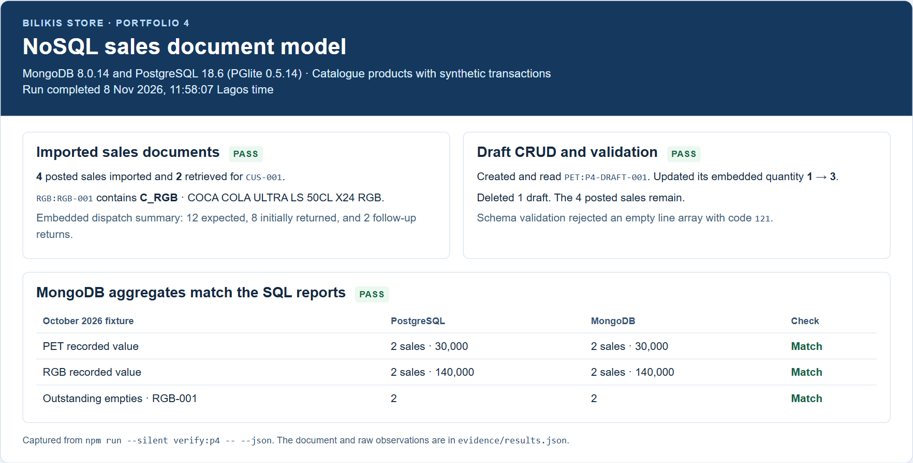

# Portfolio 4 — NoSQL and Advanced Data Models

The Bilikis sale detail screen needs the sale, its items, and its dispatch information together. This exercise projects the relational fixture into a MongoDB `sales` collection. The product codes and names come from the Bilikis catalogue. The customers, sale amounts, and dispatch activity are synthetic.

## Sales document

| Field | Model choice |
|---|---|
| `_id` | Stable key combining the sales channel and sale number, such as `RGB:RGB-001` |
| `sourceSaleId`, `customerCode` | References to the PostgreSQL sale and customer. Their ownership stays in PostgreSQL |
| `channel`, `status`, `saleDate` | Sale metadata. MongoDB stores the date as a BSON date at midnight UTC |
| `lineItems[]` | Embedded product code, catalogue label at import, unit, quantity, and the price recorded on the sale line. Quantity and unit price use BSON Decimal128 |
| `dispatch` | Optional embedded trip summary. RGB sales also carry expected empties, initial returns, and the sum of follow-up returns |

Items belong to one sale and are usually read with it. Embedding lets the application fetch them in a single document read. The snapshot repeats catalogue labels and trip details across documents, so a later catalogue edit or return requires a refresh policy. Individual follow-up events stay in PostgreSQL and the projection stores their total. [MongoDB embedding guidance](https://www.mongodb.com/docs/manual/data-modeling/embedding/)

## Relational projection

The SQL groups the priced lines of each eligible sale and totals RGB follow-ups before joining them to dispatch assignments. The projector loads the Portfolio 1 fixture, applies the Portfolio 2 catalogue entries, and gives the synthetic references short labels such as `RGB-001`. It runs the original Portfolio 2 sales and shortage reports on the same fixture and projects four sales for October 2026. [Projection SQL](sql/project-sales.sql)

Run the projection alone from the repository root with Node.js 20+.

```sh
npm ci
node portfolio-4-nosql/project-sales.mjs
```

## MongoDB operations

The verifier imports the four sale documents, creates a compound index for customer history, and finds two sales for `CUS-001` in descending date order. It then exercises each operation on a separate draft.

| Operation | Verified result |
|---|---|
| Create | `insertOne` creates `PET:P4-DRAFT-001` with one embedded line |
| Read | `findOne` reads that line with quantity 1 |
| Update | `updateOne` matches the draft and changes its quantity to 3 |
| Delete | `deleteOne` removes the draft. The four imported sales remain |
| Validate | A document with an empty line array is rejected with code `121` |

MongoDB validates required fields and BSON types, positive quantities, and nonnegative prices. The draft update modifies one document atomically. PostgreSQL remains responsible for cross-record stock integrity, as demonstrated in Portfolio 3. This exercise refreshes the MongoDB view by importing a fixture into an empty database. A live projection would need a defined refresh or change-capture process. [MongoDB atomic operations](https://www.mongodb.com/docs/manual/tutorial/model-data-for-atomic-operations/)

## Aggregation results

MongoDB multiplies quantity by the recorded unit price, sums each sale's embedded lines, and groups posted sales by channel. The shortage aggregation reads the embedded RGB return summary. Both results match the original PostgreSQL reports.

| Result | PostgreSQL | MongoDB |
|---|---:|---:|
| PET sales and recorded value | 2 sales · 30,000 | 2 sales · 30,000 |
| RGB sales and recorded value | 2 sales · 140,000 | 2 sales · 140,000 |
| Outstanding empties for `RGB-001` | 2 | 2 |

The recorded run used standalone MongoDB 8.0.14 on Windows. The evidence includes the CRUD results, index name, and a sample RGB document in MongoDB Extended JSON. [Recorded results](evidence/results.json)

## Reproduce the MongoDB checks

Use a fresh MongoDB 8 database named `bilikis_portfolio4` on loopback. The verifier checks the database name and requires an empty database. A disposable Docker container is one way to run it.

```powershell
docker run --rm --name bilikis-p4 -d -p 127.0.0.1:27087:27017 mongo:8.0
docker exec bilikis-p4 mongosh --quiet --eval "db.runCommand({ping:1}).ok"
$env:P4_MONGODB_URL = 'mongodb://127.0.0.1:27087/bilikis_portfolio4'
npm ci
npm run verify:p4
docker stop bilikis-p4
```

Wait for the ping to succeed before running the verifier. Run `npm run --silent verify:p4 -- --json` on a fresh lab database to capture the results.



Codex assisted with the data model, SQL projection, MongoDB verifier, and documentation.
